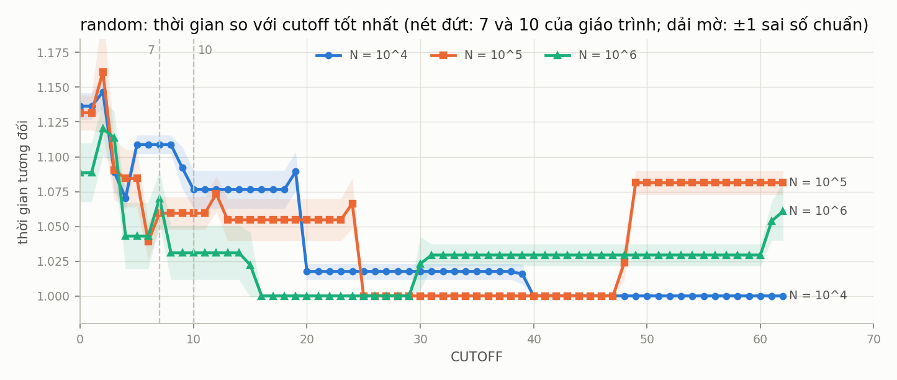

# Lưới cutoff `e1`

## Độ lệch giữa các fork (CV (coefficient of variation) - hệ số biến thiên, tính theo %)

| distribution | n | cau_hinh | cv_trung_vi | cv_p90 | cv_max |
|---|---|---|---|---|---|
| random | 10000 | 65.00 | 3.98 | 6.88 | 8.76 |
| random | 100000 | 70.00 | 4.30 | 7.79 | 11.80 |
| random | 1000000 | 70.00 | 3.37 | 6.38 | 8.24 |

## Đối chứng nhiễu: t(1)/t(0)

15 dataset: trung vị 0.992, nhỏ nhất 0.927, lớn nhất 1.056. Lý tưởng là 1,000.

## CUTOFF tốt nhất theo phân bố và N

`rel_X` = thời gian của cutoff X chia cho thời gian của cutoff tốt nhất.

| phan_bo | N | datasets | nhom_tot_nhat | khong_khac_biet_thong_ke | cham_hon_<=_2% | rel_0 | rel_7 | rel_10 | ms_tot_nhat |
|---|---|---|---|---|---|---|---|---|---|
| random | 10000 | 5 | 40–62 | 39–62 | 20–62 | 1.136 | 1.109 | 1.076 | 1.430 |
| random | 100000 | 5 | 25–47 | 25–48 | 25–47 | 1.132 | 1.059 | 1.059 | 17.880 |
| random | 1000000 | 5 | 16–29 | 4–6, 8–30 | 16–29 | 1.089 | 1.070 | 1.031 | 410.363 |

## Kết luận gộp: dữ liệu ngẫu nhiên, mọi N

- CUTOFF tốt nhất: **25**
- Không khác biệt có ý nghĩa thống kê với 25: 25–30, 39–48
- Chậm hơn 25 không quá 2%: 20–23, 25–48
- Bootstrap (2000 lần): 25 thắng 82% số lần; các cutoff chiếm 90% số lần thắng: 25, 30
- Thời gian tương đối: cutoff 0 = 1.112, 7 = 1.073, 10 = 1.049

## So sánh cặp

Tỉ số > 1 nghĩa là cutoff đứng trước chậm hơn.

| phan_bo | N | so_sanh | datasets | ti_so | ci95_thap | ci95_cao | p | cham_hon_o |
|---|---|---|---|---|---|---|---|---|
| random | 10000 | 0 vs 40 | 5 | 1.1364 | 1.1103 | 1.1631 | 0.0001 | 5/5 |
| random | 10000 | 7 vs 40 | 5 | 1.1088 | 1.0904 | 1.1275 | 0.0001 | 5/5 |
| random | 10000 | 10 vs 40 | 5 | 1.0764 | 1.0392 | 1.1149 | 0.0044 | 5/5 |
| random | 10000 | 7 vs 10 | 5 | 1.0301 | 1.0030 | 1.0579 | 0.0366 | 5/5 |
| random | 100000 | 0 vs 25 | 5 | 1.1316 | 1.0972 | 1.1672 | 0.0004 | 5/5 |
| random | 100000 | 7 vs 25 | 5 | 1.0595 | 1.0275 | 1.0925 | 0.0064 | 5/5 |
| random | 100000 | 10 vs 25 | 5 | 1.0595 | 1.0275 | 1.0925 | 0.0064 | 5/5 |
| random | 100000 | 7 vs 10 | 5 | 1.0000 |  |  |  | 0/5 |
| random | 1000000 | 0 vs 16 | 5 | 1.0885 | 1.0315 | 1.1487 | 0.0119 | 5/5 |
| random | 1000000 | 7 vs 16 | 5 | 1.0701 | 1.0170 | 1.1260 | 0.0209 | 5/5 |
| random | 1000000 | 10 vs 16 | 5 | 1.0310 | 0.9786 | 1.0863 | 0.1797 | 4/5 |
| random | 1000000 | 7 vs 10 | 5 | 1.0379 | 1.0052 | 1.0716 | 0.0321 | 5/5 |
| random (mọi N) |  | 0 vs 25 | 15 | 1.1122 | 1.0921 | 1.1326 | 0.0000 | 15/15 |
| random (mọi N) |  | 7 vs 25 | 15 | 1.0730 | 1.0555 | 1.0909 | 0.0000 | 15/15 |
| random (mọi N) |  | 10 vs 25 | 15 | 1.0494 | 1.0293 | 1.0699 | 0.0001 | 14/15 |
| random (mọi N) |  | 7 vs 10 | 15 | 1.0225 | 1.0088 | 1.0365 | 0.0033 | 10/15 |

