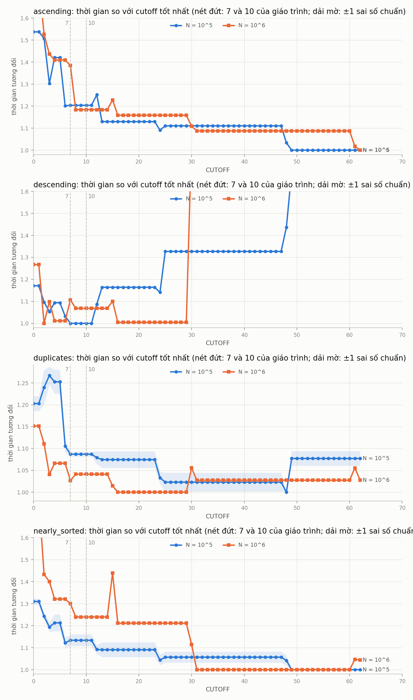
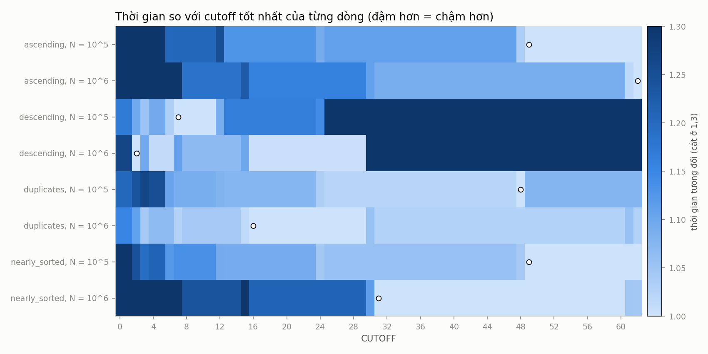

# Lưới cutoff `e2`

## Độ lệch giữa các fork (CV (coefficient of variation) - hệ số biến thiên, tính theo %)

| distribution | n | cau_hinh | cv_trung_vi | cv_p90 | cv_max |
|---|---|---|---|---|---|
| ascending | 100000 | 14.00 | 6.56 | 8.78 | 9.18 |
| ascending | 1000000 | 14.00 | 8.25 | 14.98 | 17.74 |
| descending | 100000 | 14.00 | 3.04 | 6.90 | 7.57 |
| descending | 1000000 | 14.00 | 6.41 | 15.10 | 15.96 |
| duplicates | 100000 | 70.00 | 2.23 | 5.26 | 9.40 |
| duplicates | 1000000 | 14.00 | 3.81 | 5.64 | 9.54 |
| nearly_sorted | 100000 | 70.00 | 3.20 | 7.59 | 10.07 |
| nearly_sorted | 1000000 | 14.00 | 4.97 | 18.09 | 21.80 |

## Đối chứng nhiễu: t(1)/t(0)

16 dataset: trung vị 1.011, nhỏ nhất 0.901, lớn nhất 1.073. Lý tưởng là 1,000.

## CUTOFF tốt nhất theo phân bố và N

`rel_X` = thời gian của cutoff X chia cho thời gian của cutoff tốt nhất.

| phan_bo | N | datasets | nhom_tot_nhat | khong_khac_biet_thong_ke | cham_hon_<=_2% | rel_0 | rel_7 | rel_10 | ms_tot_nhat |
|---|---|---|---|---|---|---|---|---|---|
| ascending | 100000 | 1 | 49–62 | (cần ≥ 3 seed) | 49–62 | 1.538 | 1.204 | 1.204 | 5.636 |
| ascending | 1000000 | 1 | 62 | (cần ≥ 3 seed) | 61–62 | 1.771 | 1.385 | 1.184 | 65.574 |
| descending | 100000 | 1 | 7–11 | (cần ≥ 3 seed) | 7–11 | 1.171 | 1.000 | 1.000 | 7.320 |
| descending | 1000000 | 1 | 2 | (cần ≥ 3 seed) | 2, 4–6, 16–29 | 1.267 | 1.107 | 1.068 | 94.869 |
| duplicates | 100000 | 5 | 48 | 24–48 | 48 | 1.203 | 1.087 | 1.087 | 11.446 |
| duplicates | 1000000 | 1 | 16–29 | (cần ≥ 3 seed) | 15–29 | 1.152 | 1.027 | 1.041 | 256.250 |
| nearly_sorted | 100000 | 5 | 49–62 | 24–62 | 49–62 | 1.310 | 1.134 | 1.134 | 7.546 |
| nearly_sorted | 1000000 | 1 | 31–60 | (cần ≥ 3 seed) | 31–60 | 1.781 | 1.300 | 1.240 | 108.744 |

## So sánh cặp

Tỉ số > 1 nghĩa là cutoff đứng trước chậm hơn.

| phan_bo | N | so_sanh | datasets | ti_so | ci95_thap | ci95_cao | p | cham_hon_o |
|---|---|---|---|---|---|---|---|---|
| duplicates | 100000 | 0 vs 48 | 5 | 1.2027 | 1.1571 | 1.2502 | 0.0002 | 5/5 |
| duplicates | 100000 | 7 vs 48 | 5 | 1.0870 | 1.0715 | 1.1027 | 0.0001 | 5/5 |
| duplicates | 100000 | 10 vs 48 | 5 | 1.0870 | 1.0715 | 1.1027 | 0.0001 | 5/5 |
| duplicates | 100000 | 7 vs 10 | 5 | 1.0000 |  |  |  | 0/5 |
| nearly_sorted | 100000 | 0 vs 49 | 5 | 1.3101 | 1.2732 | 1.3480 | 0.0000 | 5/5 |
| nearly_sorted | 100000 | 7 vs 49 | 5 | 1.1338 | 1.0620 | 1.2105 | 0.0060 | 5/5 |
| nearly_sorted | 100000 | 10 vs 49 | 5 | 1.1338 | 1.0620 | 1.2105 | 0.0060 | 5/5 |
| nearly_sorted | 100000 | 7 vs 10 | 5 | 1.0000 |  |  |  | 0/5 |

