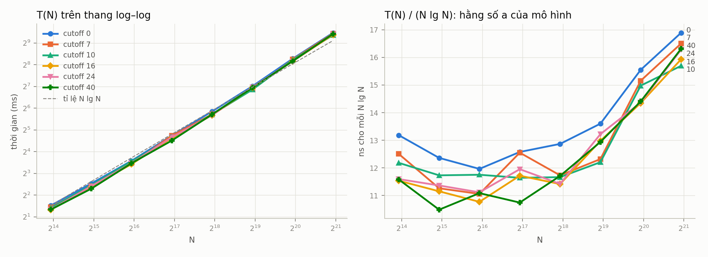

# Doubling test `e4`

## Thời gian (ms)

| n | 0 | 7 | 10 | 16 | 24 | 40 |
|---|---|---|---|---|---|---|
| 15625 | 2.870 | 2.722 | 2.652 | 2.511 | 2.524 | 2.521 |
| 31250 | 5.768 | 5.255 | 5.473 | 5.203 | 5.302 | 4.893 |
| 62500 | 11.912 | 11.009 | 11.701 | 10.725 | 11.067 | 11.038 |
| 125000 | 26.617 | 26.564 | 24.637 | 24.797 | 25.297 | 22.739 |
| 250000 | 57.687 | 52.583 | 52.292 | 51.171 | 51.189 | 52.488 |
| 500000 | 128.744 | 116.601 | 115.540 | 122.843 | 125.143 | 122.472 |
| 1000000 | 309.940 | 302.085 | 298.532 | 286.003 | 286.351 | 287.162 |
| 2000000 | 707.062 | 690.782 | 656.997 | 666.831 | 681.495 | 682.764 |

## Tỉ số T(2N)/T(N)

Cột `N lg N` là tỉ số lý thuyết nếu T(N) = a·N·lg N.

| N -> 2N | N lg N | c=0 | c=7 | c=10 | c=16 | c=24 | c=40 |
|---|---|---|---|---|---|---|---|
| 15.625 -> 31.250 | 2.144 | 2.010 | 1.930 | 2.064 | 2.072 | 2.101 | 1.941 |
| 31.250 -> 62.500 | 2.134 | 2.065 | 2.095 | 2.138 | 2.061 | 2.087 | 2.256 |
| 62.500 -> 125.000 | 2.126 | 2.234 | 2.413 | 2.106 | 2.312 | 2.286 | 2.060 |
| 125.000 -> 250.000 | 2.118 | 2.167 | 1.979 | 2.122 | 2.064 | 2.024 | 2.308 |
| 250.000 -> 500.000 | 2.112 | 2.232 | 2.217 | 2.210 | 2.401 | 2.445 | 2.333 |
| 500.000 -> 1.000.000 | 2.106 | 2.407 | 2.591 | 2.584 | 2.328 | 2.288 | 2.345 |
| 1.000.000 -> 2.000.000 | 2.100 | 2.281 | 2.287 | 2.201 | 2.332 | 2.380 | 2.378 |

## Mô hình T(N) ≈ a·N^b

| khoang | b (N lg N) | b c=0 | b c=7 | b c=10 | b c=16 | b c=24 | b c=40 |
|---|---|---|---|---|---|---|---|
| mọi N (15.625–2.000.000) | 1.084 | 1.140 | 1.147 | 1.137 | 1.153 | 1.153 | 1.162 |
| nửa nhỏ (15.625–250.000) | 1.091 | 1.086 | 1.088 | 1.077 | 1.095 | 1.094 | 1.098 |
| nửa lớn (250.000–2.000.000) | 1.074 | 1.211 | 1.252 | 1.232 | 1.233 | 1.240 | 1.233 |

