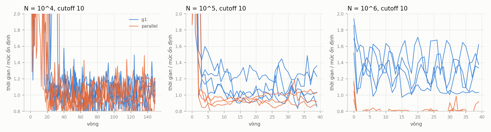

# Pilot `pilot_ss`

## Warm-up

Độ lệch (%) của trung bình M vòng bắt đầu từ vòng w so với M vòng cuối; đủ khi p90 ≤ 2%.

**g1, N = 10^4**: chưa đủ trong khoảng đã thử

| w | mean_dev_pct | p90_dev_pct | max_dev_pct |
|---|---|---|---|
| 0 | 235.21 | 353.33 | 356.15 |
| 5 | 185.67 | 285.53 | 312.05 |
| 10 | 127.39 | 236.62 | 265.45 |
| 15 | 78.35 | 154.71 | 254.76 |
| 20 | 51.17 | 158.51 | 208.84 |
| 30 | 33.83 | 150.67 | 169.06 |
| 40 | 22.00 | 75.89 | 124.89 |
| 50 | 6.17 | 11.52 | 12.54 |
| 75 | 4.73 | 9.00 | 10.52 |

**g1, N = 10^5**: chưa đủ trong khoảng đã thử

| w | mean_dev_pct | p90_dev_pct | max_dev_pct |
|---|---|---|---|
| 0 | 78.87 | 95.93 | 98.34 |
| 5 | 9.74 | 23.86 | 29.55 |
| 10 | 5.52 | 16.82 | 24.60 |
| 15 | 5.13 | 13.93 | 26.20 |
| 20 | 4.92 | 8.77 | 28.94 |

**g1, N = 10^6**: chưa đủ trong khoảng đã thử

| w | mean_dev_pct | p90_dev_pct | max_dev_pct |
|---|---|---|---|
| 0 | 8.89 | 14.24 | 46.99 |
| 5 | 6.19 | 7.90 | 40.42 |
| 10 | 3.81 | 6.86 | 21.39 |
| 15 | 1.48 | 2.54 | 4.27 |
| 20 | 1.69 | 3.90 | 7.32 |

**parallel, N = 10^4**: chưa đủ trong khoảng đã thử

| w | mean_dev_pct | p90_dev_pct | max_dev_pct |
|---|---|---|---|
| 0 | 211.61 | 297.51 | 305.08 |
| 5 | 169.15 | 245.76 | 281.91 |
| 10 | 108.42 | 182.32 | 195.20 |
| 15 | 68.87 | 172.85 | 209.75 |
| 20 | 42.68 | 147.76 | 191.53 |
| 30 | 24.73 | 57.95 | 160.58 |
| 40 | 8.35 | 16.59 | 31.95 |
| 50 | 5.05 | 10.47 | 13.51 |
| 75 | 3.48 | 7.02 | 8.21 |

**parallel, N = 10^5**: chưa đủ trong khoảng đã thử

| w | mean_dev_pct | p90_dev_pct | max_dev_pct |
|---|---|---|---|
| 0 | 75.04 | 99.41 | 119.97 |
| 5 | 2.83 | 5.34 | 6.87 |
| 10 | 2.93 | 4.41 | 7.27 |
| 15 | 2.11 | 4.38 | 5.96 |
| 20 | 2.03 | 4.17 | 5.01 |

**parallel, N = 10^6**: chưa đủ trong khoảng đã thử

| w | mean_dev_pct | p90_dev_pct | max_dev_pct |
|---|---|---|---|
| 0 | 5.47 | 7.91 | 21.46 |
| 5 | 2.19 | 4.92 | 8.65 |
| 10 | 2.52 | 5.44 | 8.14 |
| 15 | 2.28 | 5.11 | 6.76 |
| 20 | 3.23 | 8.40 | 9.30 |

## Độ lệch giữa các fork (CV, %)

| variant | n | cutoff | forks | mean_ms | cv_pct | fork_means_ms |
|---|---|---|---|---|---|---|
| g1 | 10000 | 0 | 4 | 1.576 | 13.779 | 1.379 1.499 1.542 1.885 |
| g1 | 10000 | 10 | 4 | 1.619 | 12.879 | 1.326 1.620 1.734 1.796 |
| g1 | 10000 | 32 | 4 | 1.398 | 13.734 | 1.230 1.250 1.484 1.628 |
| g1 | 100000 | 0 | 4 | 20.768 | 13.454 | 18.178 20.006 20.151 24.736 |
| g1 | 100000 | 10 | 4 | 23.824 | 13.486 | 20.099 22.203 26.216 26.781 |
| g1 | 100000 | 32 | 4 | 19.106 | 7.622 | 16.977 19.431 19.787 20.229 |
| g1 | 1000000 | 0 | 4 | 357.181 | 4.550 | 343.287 350.902 353.916 380.619 |
| g1 | 1000000 | 10 | 4 | 521.955 | 14.059 | 424.294 514.647 551.486 597.393 |
| g1 | 1000000 | 32 | 4 | 387.012 | 6.787 | 348.215 394.212 400.224 405.399 |
| parallel | 10000 | 0 | 4 | 1.579 | 7.480 | 1.499 1.510 1.555 1.753 |
| parallel | 10000 | 10 | 4 | 1.607 | 12.820 | 1.331 1.601 1.669 1.825 |
| parallel | 10000 | 32 | 4 | 1.402 | 6.533 | 1.316 1.365 1.397 1.530 |
| parallel | 100000 | 0 | 4 | 19.313 | 7.826 | 17.951 18.593 19.280 21.429 |
| parallel | 100000 | 10 | 4 | 19.492 | 14.161 | 15.880 18.979 20.835 22.274 |
| parallel | 100000 | 32 | 4 | 17.434 | 5.519 | 16.215 17.132 18.046 18.343 |
| parallel | 1000000 | 0 | 4 | 325.513 | 5.875 | 307.905 310.243 339.351 344.552 |
| parallel | 1000000 | 10 | 4 | 309.497 | 4.213 | 295.031 302.491 316.987 323.480 |
| parallel | 1000000 | 32 | 4 | 324.549 | 8.188 | 302.851 313.158 319.063 363.124 |

Trung vị CV theo GC: g1 13.45%, parallel 7.48%

**Quyết định:** dùng ParallelGC (quy tắc: đổi sang ParallelGC chỉ khi trung vị CV thấp hơn G1 ít nhất 1 điểm phần trăm; chênh lệch đo được +5.97).

Thời gian trung bình (ms) theo GC:

| n | cutoff | g1 | parallel | parallel/g1 |
|---|---|---|---|---|
| 10000 | 0 | 1.576 | 1.579 | 1.002 |
| 10000 | 10 | 1.619 | 1.607 | 0.992 |
| 10000 | 32 | 1.398 | 1.402 | 1.003 |
| 100000 | 0 | 20.768 | 19.313 | 0.930 |
| 100000 | 10 | 23.824 | 19.492 | 0.818 |
| 100000 | 32 | 19.106 | 17.434 | 0.912 |
| 1000000 | 0 | 357.181 | 325.513 | 0.911 |
| 1000000 | 10 | 521.955 | 309.497 | 0.593 |
| 1000000 | 32 | 387.012 | 324.549 | 0.839 |

